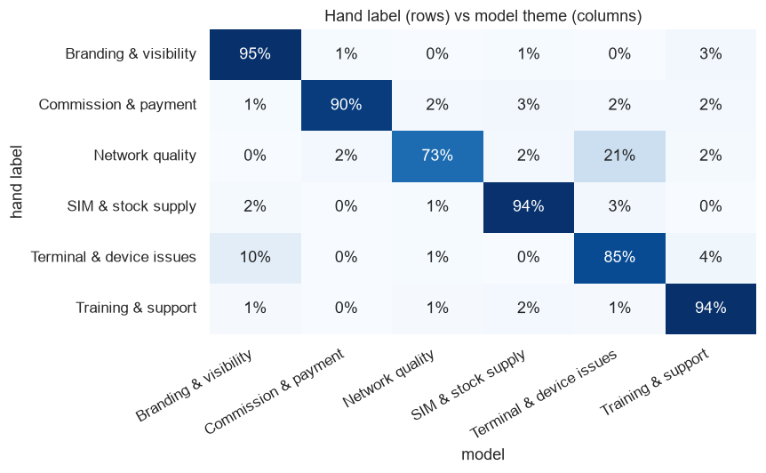
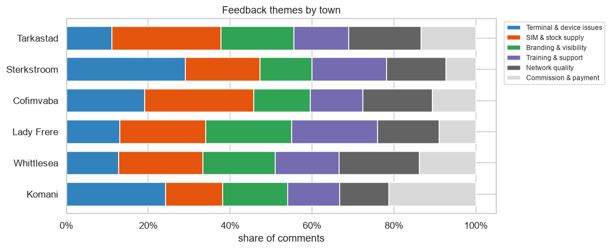
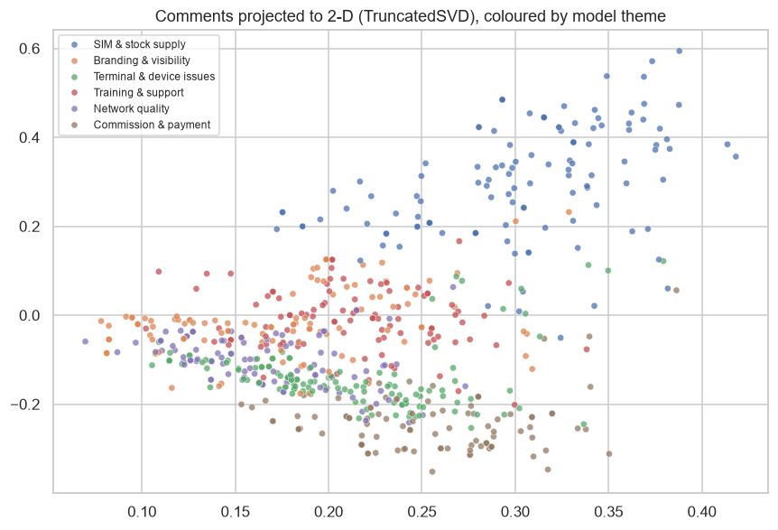

# Survey Feedback Theme Tagging (NLP)

Automatically groups **640 open-ended comments** from informal-market outlet owners into themes such as network quality, stock supply, commission and branding, then reports which issues matter most in each town.

**Tools:** Python · scikit-learn (TF-IDF, K-Means, silhouette, TruncatedSVD) · pandas · seaborn

> 📓 **[Open the notebook](theme_tagging.ipynb)**: it has been run end-to-end and all outputs are visible.

---

## The problem
Field surveys collect lots of free text, such as *"the airtime machine is offline often"* or *"we ran out of sim cards last week"*. Tagging it by hand takes days, so it often goes unread. This project builds a fast, explainable baseline that tags it automatically.

## Approach
1. **TF-IDF** on unigrams and bigrams, with English stop words removed
2. **Choose k** by silhouette score
3. **K-Means** clustering, then an analyst names each cluster from its top terms
4. **Evaluate** against a hand-labelled set (used only for scoring, never for training)
5. **Report** the theme mix by town and export `data/tagged_feedback.csv`

## Results
- **88% agreement with hand labels** (Adjusted Rand Index 0.59)
- **SIM & stock supply is the top issue outside Komani** (21–27% of comments). Komani skews toward commission and terminal issues.
- **Known blind spot:** network complaints are **undercounted** (15% vs 20% in the hand labels), because "slow" pulls some of them into the device cluster. I flag this in the notebook rather than hide it.
- Most errors are comments that raise **two issues at once**, which makes the case for multi-label (LLM-assisted) tagging.





## Why a non-LLM baseline?
I've piloted LLM-assisted tagging of survey responses. A classical baseline like this one is cheap, explainable, needs no API calls, and gives the LLM approach a measurable target to beat.

## Run it yourself
```bash
pip install -r requirements.txt
python src/generate_data.py
python build_notebook.py
```

## About the data
**The comments are synthetic**, generated from phrase templates with typos, filler and mixed themes to imitate real field feedback.
